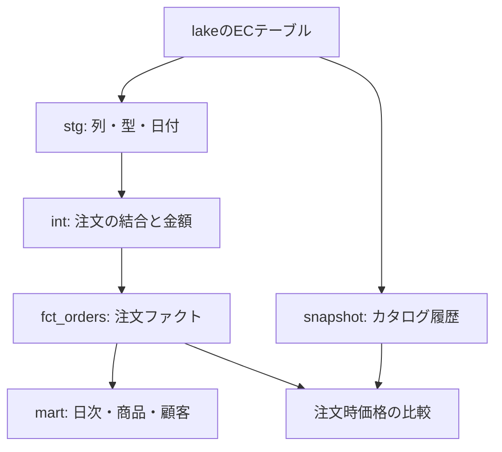

# SmallDataAnalyticsPlatform2（dap2）学習カリキュラム

作成日：2026-11-07 / 版：1.0 / 進捗：未着手

設計の正本：[dap2仕様書](https://chatgpt.com/library?file_id=libfile_dde5e5ef28b08191be559138b613cb13&account_id=personal)（作成時 v0.5）。
形式の参考：[既存の学習カリキュラム](https://chatgpt.com/library?file_id=libfile_5af8ea944a80819184bfd9416426cc74&account_id=personal)。元資料の「やること・理解チェック・完了条件」と段階的な進行を引き継ぎ、dap2の要件に合わせて新規作成した。元資料の完了済みチェックは引き継がない。

## 学習の到達点

Macで毎日増える架空ECデータを、自分で作ったdbtモデルへ加工できるようになる。最終的に、売上の根拠、データ品質、過去価格、増分処理の限界をSQLと数字で説明する。

学ぶ対象は「生成されたデータをdbtで扱うこと」が中心。基盤準備はPhase 0〜3、dbtの実践はPhase 4〜11。基盤が既に用意されている場合も完了条件は実際に確認し、確認できたステップのみ完了にする。

### このカリキュラムの前提

- 正式名称：SmallDataAnalyticsPlatform2。略称：dap2。既存dapとは別リソース。
- Macで完結し、開発＝本番。同じDB・同じ接続ユーザー・単一targetを使用する。
- データ生成は **Mac cron → run_daily.sh → Docker Compose → コンテナ内generator/daily.py → lake**。
- 呼び出すたびに追加・更新する。日付キーでのスキップは行わない。
- dbtは利用者が `dbt init` から実装する。本書は作業指示と検証方法であり、完成済みモデルの配布ではない。
- dbt未作成でも生成を開始できる。snapshotは学習を始めた時点から観測する。
- dlt、Airflow、Raspberry Pi、SSHデプロイ、dev/prod分離は本カリキュラムに含めない。

### 進め方

1. 1ステップ30〜90分を目安に進める。基盤構築や障害対応は2時間以上かかってもよい。期間の保証ではない。
2. 「学ぶこと」を読んでから、番号付き作業を自分で実行する。
3. 理解チェックに自分の言葉で答え、完了条件を確認して `[ ]` を `[x]` にする。
4. 各Phaseの結果は `docs/learning/phase-NN.md` に、期待結果・実測・失敗原因・次回の注意を記録する。
5. PhaseごとにGitへコミットする。任意で `dap2-phase-04` のようなタグを付ける。GitHubへのpushは利用者が設定済みなら行えばよい。
6. 件数や価格を比較する演習ではdap2のcronだけを一時停止し、終了後に戻す。学習用の観測を固定する操作であり、生成をsnapshotに依存させる仕組みは追加しない。
7. AIには「このステップのヒント」「失敗の原因」「書いたSQLのレビュー」を依頼する。dbtの初期化・モデル作成・実行は利用者が行う。

### 実行場所を混同しない

| 場所 | 行うこと | DB接続先 |
|---|---|---|
| Macターミナル | Compose、.sh、cron、Git | 必要時は127.0.0.1:ホスト公開ポート |
| MacのDBeaver | lakeと加工結果の確認 | 127.0.0.1:15432（暫定） |
| generatorコンテナ | Pythonによる生成 | postgres:5432 |
| dbt Dev Container | dbt init、SQL編集、dbt実行 | postgres:5432 |

### 完成させるモデルの見取り図

stg / int / fct / martはモデルの役割であり、別のDockerコンテナではない。本書では同じanalyticsスキーマ内で、フォルダとモデル名によって分ける。

## 進捗サマリー

| Phase | 内容 | ステップ | 完了 |
|---|---|---:|---:|
| 0 | 全体像と学習準備 | 3 | 0 / 3 |
| 1 | リポジトリとPostgreSQL | 3 | 0 / 3 |
| 2 | ECデータを生む仕組み | 4 | 0 / 4 |
| 3 | Macのcronでデータを育てる | 3 | 0 / 3 |
| 4 | Dev Containerとdbtの第一歩 | 4 | 0 / 4 |
| 5 | Stagingと基本テスト | 3 | 0 / 3 |
| 6 | Intermediateと売上Mart | 4 | 0 / 4 |
| 7 | 失敗から学ぶテストとデバッグ | 3 | 0 / 3 |
| 8 | 価格snapshotと履歴分析 | 3 | 0 / 3 |
| 9 | 注文ファクトのincremental | 3 | 0 / 3 |
| 10 | 再利用・契約・ドキュメント | 4 | 0 / 4 |
| 11 | 通し演習と修了レビュー | 3 | 0 / 3 |

**合計：12 Phase・40ステップ。** Phase 6までで売上Mart、Phase 9までで履歴・増分、Phase 11までで全課題が完成する。

## Phase 0：全体像と学習準備

**目標：** 作るものと、各処理の責任を説明する。

**前提：** なし。仕様書とこのカリキュラムを用意する。

### 0-1. 目的とデータの流れを書く

**実行場所：** Mac・学習ノート

**学ぶこと：** データを生む処理と、データを分析用に加工する処理の違い。

**やること：**

1. 仕様書の目的・R01〜R10を読む。
2. cron → .sh → コンテナ内Python → lake と、lake → dbt → 分析用モデルを自分で描く。
3. 「毎日の売上」「よく売れる商品」「顧客別の購入状況」の3つの問いを書く。

**理解チェック：** Pythonとdbtはそれぞれ何を書き換えるか。dbtが未作成でも生成を始められるのはなぜか。

- [ ] **完了条件：** 3つの問いと役割分担を docs/learning/00-goals.md に書き、図を見ずに説明できる。

### 0-2. 既存dapとdap2の境界を確認する

**実行場所：** Macターミナル

**学ぶこと：** Composeのプロジェクト名、実リソース名、ホストのポートは別の概念。

**やること：**

1. 既存コンテナ・ネットワーク・ボリュームと公開ポートを読み取りで確認する。
2. dap2 / dap2_pgdata / dap2_warehouse / dap2-dbt の命名表を作る。
3. ホスト15432の空きを確認する。競合していればdap2側の候補を変更して記録する。既存dapには変更を加えない。

**理解チェック：** 名前にdap2を付けてもポート競合が起きるのはなぜか。postgresというサービスキーと実コンテナ名は同じか。

- [ ] **完了条件：** 使用するリソース名とポートが決まり、既存dapとの非共有を説明できる。

‐ 15433に変更する

### 0-3. 学習用の暫定値を記録する

**実行場所：** Mac・学習ノート

**学ぶこと：** 確定した要件と、教材を進めるための仮置きを区別する。

**やること：**

1. 末尾の「暫定値一覧」を読む。初回24時間、local/analytics、generator_state、金額の桁を確認する。
2. 自分が使う値を docs/learning/00-decisions.md に記録する。未決の箇所をそのまま放置せず、該当実装前に決める。
3. MacのCPU、OS、Dockerの版を記録する。依存版は導入確認後に記録する欄を作る。

**理解チェック：** 仕様の候補バージョンと、実機で動作を確認したバージョンの違いは何か。

- [ ] **完了条件：** 学習の前提と未確認事項を区別した1ページのメモがある。

## *Phase 1：リポジトリとPostgreSQL*

***目標：** 専用DBを起動し、DBeaverで中身を見る。*

***前提：** Phase 0 の完了条件を満たしていること。*

### *1-1. dap2専用の作業場所を作る*

***実行場所：** Mac・エディタ*

***学ぶこと：** Gitはソースと設定例を記録し、DBの中身や秘密情報とは分ける。*

***やること：***

1. *dap2専用ディレクトリとGitリポジトリを用意する。既存dapを流用先にしない。*
2. *generator/、postgres/init/、.devcontainer/dbt/、dbt/、docs/learning/を用意する。dbt/dap2はまだ作らない。*
3. *.env.exampleと.gitignoreを作り、.env、ログ、dbtの生成物を追跡対象から除外する。*

***理解チェック：** なぜdbt/dap2を先に完成させないのか。Gitでコードを戻すとDBのデータも戻るか。*

- [ ] ***完了条件：** git statusで秘密情報が含まれず、READMEに正式名称・略称・目的がある。*

### 1-2. Composeで専用DBを起動する

**実行場所：** Macターミナル・Compose

**学ぶこと：** image/container/volume/networkを区別する。

**やること：**

1. docker-compose.ymlにPostgreSQLを定義し、プロジェクトdap2、ネットワークdap2、ボリュームdap2_pgdataを設定する。
2. dap2_warehouseと共通ユーザーdap2、JST設定、ループバック限定のポート公開、healthcheckを用意する。
3. PostgreSQLだけを起動し、実リソース名とログを確認する。依存する初期化SQLはこの段階ではDBとlakeの準備に留めてもよい。

**理解チェック：** コンテナを止めることと永続ボリュームを削除することは何が違うか。

- [ ] **完了条件：** PostgreSQLが利用可能で、dap2以外のリソースを変更していない。

### 1-3. DBeaverで接続しSQLを読む

**実行場所：** Mac・DBeaver

**学ぶこと：** ホスト接続とコンテナ間接続の違い、DBとschemaの違い。

**やること：**

1. 127.0.0.1、決めたホストポート、dap2_warehouseで接続する。SSHトンネルは使わない。
2. SELECT current_database(), current_user; と SHOW timezone; を実行する。
3. schema一覧を確認し、後でlakeとanalyticsがどう役割分担するかノートに書く。

**理解チェック：** DBeaverは15432、コンテナ内のdbtは5432を使うのはなぜか。

- [ ] **完了条件：** 接続先とJST設定を確認し、接続手順をパスワードなしで記録できる。

## Phase 2：ECデータを生む仕組み

**目標：** 毎回の追加・更新と、失敗時のロールバックを体験する。

**前提：** Phase 1 の完了条件を満たしていること。

### 2-1. 元コードを読み、初期データを用意する

**実行場所：** Macで編集・PostgreSQLで実行

**学ぶこと：** テーブルの粒度、主キー、外部キー、流用元の記録。

**やること：**

1. pg-trickleの対象SQLとPythonを読み、固定コミット・ライセンス・変更箇所を記録する。拡張本体は導入しない。
2. lakeに5つの業務テーブルを作り、カテゴリ8・商品15・顧客30・注文50・カタログ15を用意する。
3. 初期データが既にある場合は二重投入せず件数と列を確認する。初期化SQLの変更は既存ボリュームへ自動再適用されると考えず、必要な変更を明示的に行う。

**理解チェック：** ordersの1行は何を表すか。1注文に複数商品を入れたい場合、現在の設計で表現できるか。

- [ ] **完了条件：** 5表の件数・主キー・外部キーと実際の列名を docs/learning/02-data-dictionary.md に記録した。

### 2-2. 1回で終了するgeneratorを作る

**実行場所：** Macで編集・generatorコンテナで実行

**学ぶこと：** INSERTとUPDATE、Pythonの実行環境、生成値の意味。

**やること：**

1. 流用関数を小さく修正し、既定で注文10件・価格更新1商品を行うdaily.pyを作る。無限ループは設けない。
2. 依存をgeneratorのイメージへ入れ、Mac上でビルド・接続・実行を確認する。
3. 実行前後の件数、変更対象商品、旧価格・新価格を記録する。注文→価格更新の順を確認する。

**理解チェック：** 基準価格、現在価格、注文の販売単価のどれを売上計算に使うか。

- [ ] **完了条件：** 通常1実行で注文が10件増える。価格更新が設定した規則内であることを確認できる。

### 2-3. 前回から今回までの時刻をランダム生成する

**実行場所：** generatorコンテナ・DBeaver

**学ぶこと：** イベント時刻と処理時刻、成功時のみ状態を進める理由。

**やること：**

1. generator_state案を使い、初期化基準時刻を保存する。初期50注文は暫定で直前24時間とする。
2. トランザクション内で状態行をロックした後に今回基準時刻を取得し、前回より後〜今回以下の注文時刻を生成する。
3. 連続2回実行し、各回の注文ID範囲と時刻の最小・最大を記録する。同日でも計20件増えることを確認する。

**理解チェック：** 注文時刻の最大値を前回成功時刻として使わないのはなぜか。IDが大きい注文ほどordered_atも必ず新しいか。

- [ ] **完了条件：** 各回の注文が決めた時刻区間に入り、同日再実行が抑止されない。

### 2-4. 失敗と再実行を確かめる

**実行場所：** generatorコンテナ・DBeaver

**学ぶこと：** 1回の原子性と、複数回実行の重複防止は別物。

**やること：**

1. dap2のcronが未登録の状態で、注文追加後・コミット前に例外を起こすテスト経路を一時的に用意する。
2. 件数・価格・last_success_atが変わらず、非ゼロ終了とログが残ることを確認してテスト経路を除去する。
3. 正常実行後にもう一度正常実行し、毎回新しい注文が追加されることを確認する。

**理解チェック：** ロールバックしてもIDに欠番があってよいのはなぜか。「同じ処理を2回呼ぶ」と「1回の途中失敗」は同じか。

- [ ] **完了条件：** 失敗時は部分更新なし、正常な再実行時は追加あり、という比較表がある。

## Phase 3：Macのcronでデータを育てる

**目標：** cron → .sh → .pyを自分で設定する。

**前提：** Phase 2 の完了条件を満たしていること。

### 3-1. run_daily.shを作る

**実行場所：** Macターミナル

**学ぶこと：** シェルは起動と環境設定、Pythonは生成処理を担当する。

**やること：**

1. run_daily.shにdap2の作業ディレクトリ、Composeファイル、プロジェクト名、Docker CLIの参照先を明示する。
2. 一時generatorコンテナ内のdaily.pyを呼び、終了コードを伝える。ホストにDBドライバーは入れない。
3. プロジェクト外のディレクトリから.shを起動しても正しく動き、ログがdap2側に残ることを確認する。

**理解チェック：** cronから呼ぶときだけ動かない原因としてPATH・作業ディレクトリ・環境変数をどう調べるか。

- [ ] **完了条件：** .shから10件追加され、失敗時の終了コードもMacまで伝わる。

### 3-2. cronに登録して2回観察する

**実行場所：** Macターミナル

**学ぶこと：** スケジュールとデータ生成件数を分けて考える。

**やること：**

1. 既存crontabを確認し、既存dapの登録を残したままdap2の.shを追加する。
2. 学習中だけ5分間隔にして、MacとDockerを稼働させた状態で2回観察する。
3. ログ時刻・注文件数を照合し、その後は07:00 JSTの日次設定へ戻す。dbtはまだ呼ばない。

**理解チェック：** 5分に変えたら1日分の10件を分割するのか、それとも毎回10件か。

- [ ] **完了条件：** cron経由の2回で20件増え、日次設定へ戻した記録がある。

### 3-3. 停止時の挙動と学習中の一時停止を覚える

**実行場所：** Mac・学習ノート

**学ぶこと：** スケジューラーの実行と、Mac/Dockerの稼働は別の条件。

**やること：**

1. dap2の登録だけを一時停止・再開する手順を記録する。以降、件数を比較する演習ではこの手順を使う。
2. 生成できない場合にログ・Docker・DBを順に確認する手順を作る。
3. 長時間空けた次の1回も件数は10件、時刻の生成区間は前回成功から今回まで、という期待結果を書く。

**理解チェック：** Macの停止中に実行予定だった回数が自動で補完される仕様か。snapshotの失敗で生成を止めるか。

- [ ] **完了条件：** 起動・停止・エラー確認・再開の手順がREADMEにあり、既存dapの登録を触らない。

## Phase 4：Dev Containerとdbtの第一歩

**目標：** 利用者自身がdbt initし、最初のSELECTをモデルにする。

**前提：** Phase 3 の完了条件を満たしていること。

### 4-1. Macでdap2-dbtを開く

**実行場所：** Mac・VS Code Dev Container

**学ぶこと：** 編集用コンテナと常駐DBは役割が違う。

**やること：**

1. .devcontainer/dbt/の4ファイルを作り、dap2ネットワークとワークスペースを設定する。
2. 互換性を確認したdbt Core/adapterとdbt Power Userを入れる。実際の版を記録する。
3. コンテナ内のPython/dbtパスとpostgres:5432への接続を確認する。post-createではdbt initを実行しない。

**理解チェック：** コンテナ内のlocalhostはMacのDBを指すか。Power Userの表示名だけで実行環境を判断できるか。

- [ ] **完了条件：** dap2-dbtを再度開いてもdbt --versionが成功し、実コンテナ名にdap2がある。

### 4-2. 自分でdbt initする

**実行場所：** dbt Dev Container

**学ぶこと：** プロジェクトの設定と、モデルSQLの配置。

**やること：**

1. ワークスペースのdbt/へ移動し、利用者自身がdbt init dap2を実行する。
2. 作られたdbt_project.yml、models/、macros/、seeds/、snapshots/を確認する。
3. サンプルモデルの役割を読んだ後、以降の演習に混ざらないよう削除または無効化する。

**理解チェック：** dbt_project.ymlは接続パスワードを保存するファイルか。AIが事前にモデルを完成させると何を学び損ねるか。

- [ ] **完了条件：** dbt/dap2が自分の操作で作成され、各ディレクトリの用途を説明できる。

### 4-3. 接続プロファイルを設定する

**実行場所：** dbt Dev Container

**学ぶこと：** profile、target、database、schemaの対応。

**やること：**

1. profile dap2、単一target local、database dap2_warehouse、schema analyticsを学習用の暫定値として設定する。
2. ユーザー・パスワードは環境変数参照にする。hostはpostgres、portは5432。
3. DBT_PROFILES_DIRを実際のprofiles.yml配置先へ設定し、dbt debugを実行する。

**理解チェック：** localというtarget名はdev/prod分離を意味するか。schema analyticsとdatabase dap2_warehouseは何が違うか。

- [ ] **完了条件：** dbt debugが成功し、接続情報に秘密値を直書きしていない。

### 4-4. sourceと最初のモデルを作る

**実行場所：** dbt Dev Container・DBeaver

**学ぶこと：** sourceは既存データへの入口、modelはSELECTで定義する加工結果。

**やること：**

1. source名ec、schema lakeとしてordersをYAMLで宣言する。sourceはlakeの表を新規作成する命令ではないことを確認する。
2. stg_orders.sqlを作り、source経由で列を明示して読む。idをorder_idへ変えるなど、命名を整える。
3. dbt run --select stg_ordersを実行し、analytics側の結果とlakeの件数を比較する。

**理解チェック：** SQLにlake.ordersを直書きする方法とsourceを使う方法では依存関係の表現がどう違うか。

- [ ] **完了条件：** 自分で書いた最初のモデルが動き、元のlakeを書き換えていない。

## Phase 5：Stagingと基本テスト

**目標：** 5つの元テーブルを、意味が揃った入口にする。

**前提：** Phase 4 の完了条件を満たしていること。

### 5-1. 5表のStagingを揃える

**実行場所：** dbt Dev Container

**学ぶこと：** Stagingでは粒度を維持して列・型・名称を整える。

**やること：**

1. 残り4表をsourceに加え、stg_categories/products/customers/product_catalogを作る。
2. 主キーをcategory_id/product_id/customer_idとして統一し、元列とモデル列の対応表を作る。
3. stg_ordersの単価をunit_price、数量をquantity、日時をordered_atとして扱えるようにする。実際の元列が違えば対応させる。

**理解チェック：** Stagingで商品別売上へ集約すると、後から注文単位の分析がしにくくなるのはなぜか。

- [ ] **完了条件：** 5モデルが同じ入力の件数・粒度を維持し、必要列の型が明示されている。

### 5-2. JSTの日付とmaterializationを確認する

**実行場所：** dbt Dev Container・DBeaver

**学ぶこと：** 時刻から日付を作るときのタイムゾーン、viewとtableの更新タイミング。

**やること：**

1. ordered_atから明示的にJSTの日付order_date_jstを作る。
2. UTCの14:59と15:00に相当する2つの固定時刻をSELECTで試し、JSTの日付境界を確かめる。
3. stg_ordersでviewとtableを順に試し、生成後・dbt再実行前の見え方を比較して採用設定へ戻す。

**理解チェック：** table形式のモデルはlake更新だけで新しい行が現れるか。セッションのtimezoneに任せると何が曖昧か。

- [ ] **完了条件：** 日付境界の期待結果と、view/tableの更新時点を表にできる。

### 5-3. 主キー・参照関係をdata testにする

**実行場所：** dbt Dev Container

**学ぶこと：** データの品質を、毎回確認できるルールにする。

**やること：**

1. 主キーにuniqueとnot_nullを付ける。
2. ordersの商品・顧客、productsのカテゴリ、catalogの商品についてrelationshipsを設定する。
3. 数量が正、販売単価が負でないことを検査するsingular testを追加して実行する。

**理解チェック：** relationshipsだけでNULL禁止も保証されるか。singular testで返すのは正常行か違反行か。

- [ ] **完了条件：** dbt testで実データを検査でき、各テストが守るルールを1文ずつ説明できる。

## Phase 6：Intermediateと売上Mart

**目標：** 注文単位の計算を再利用し、3つの分析へつなげる。

**前提：** Phase 5 の完了条件を満たしていること。

### 6-1. 注文金額を手計算してからモデルにする

**実行場所：** 学習ノート・dbt Dev Container

**学ぶこと：** 粒度とメジャーの定義を先に決める。

**やること：**

1. 数量2・単価120の注文を例に、注文金額240を手計算する。
2. int_orders_enrichedを作り、stg_ordersから注文金額を計算し、商品・顧客・カテゴリをrefで結合する。
3. 結合前後の行数とorder_idの一意性を比べる。現在価格を過去売上の計算に使用しない。

**理解チェック：** 右側に同じproduct_idが2行あると売上がどう変わるか。LEFT JOINで行数が増えることはあるか。

- [ ] **完了条件：** 1注文1行を保ち、選んだ3注文の金額が手計算と一致する。

### 6-2. 注文ファクトと日次売上を作る

**実行場所：** dbt Dev Container・DBeaver

**学ぶこと：** ファクトは事実の粒度、Martは利用目的に合わせた集約。

**やること：**

1. fct_ordersをまず通常のtableとして作る。ここではまだincrementalにしない。
2. mart_daily_salesをJST日付ごとに作り、注文件数・販売数量・売上・平均注文額を出す。
3. 件数比較中はdap2のcronを一時停止する。lake→int→fct→日次Martの総売上を比較する。

**理解チェック：** 注文件数と販売数量はなぜ違うか。売上ゼロの日と行が存在しない日は同じ意味か。

- [ ] **完了条件：** 日次Martの総売上が元注文の数量×実績単価の総和と一致する。

### 6-3. 商品別・顧客別のMartを作る

**実行場所：** dbt Dev Container・DBeaver

**学ぶこと：** 同じファクトから異なる切り口を作る。

**やること：**

1. mart_product_salesとmart_customer_salesを作り、それぞれ1商品1行、1顧客1行を目標にする。
2. 上位5商品・上位5顧客を取得し、売上・件数・数量の違いを説明する。
3. 購入実績ゼロのマスターを含めるかを決め、含める場合は外部結合と0埋めを実装する。

**理解チェック：** LEFT JOIN後のCOUNT(*)は購入ゼロの顧客に対して何を数えるか。

- [ ] **完了条件：** ゼロ件の扱いを明記し、商品別・顧客別・日次の総売上が一致する。

### 6-4. ref・依存関係・buildを確かめる

**実行場所：** dbt Dev Container

**学ぶこと：** 実行順はファイル名でなくモデルの依存関係から決まる。

**やること：**

1. dbt lsでモデルを確認し、source→stg→int→fct→martの依存関係を描く。
2. dbt build --select +mart_daily_salesを実行し、上流を含めた選択を確認する。
3. 生成しないままもう一度buildし、件数・売上が変わらないことを確認する。終了後に停止したcronを戻す。

**理解チェック：** generatorの再実行とdbtの再実行で期待結果が違うのはなぜか。dbt runとbuildは何が違うか。

- [ ] **完了条件：** 入力固定時の再実行で重複せず、選択したモデルとテストの結果を説明できる。

## Phase 7：失敗から学ぶテストとデバッグ

**目標：** 失敗を分類し、固定データでロジックを検証する。

**前提：** Phase 6 の完了条件を満たしていること。

### 7-1. data testを意図的に失敗させる

**実行場所：** dbt Dev Container

**学ぶこと：** テストの成功だけでなく検出能力を確認する。

**やること：**

1. lakeに不正データを入れる代わりに、一時的な学習モデルで同じorder_idを2行返す。
2. unique testの失敗を確認し、違反行をSELECTで特定する。
3. 学習モデルを修正・削除し、通常モデルのテストが再び通る状態へ戻す。

**理解チェック：** SQLの文法エラーとデータテストの失敗は、調べる場所がどう違うか。

- [ ] **完了条件：** 失敗ログ・原因・修正・再実行結果を1件記録できる。

### 7-2. unit testで小さな入力を与える

**実行場所：** dbt Dev Container

**学ぶこと：** 実データを検査するdata testと、固定入力で計算を検査するunit test。

**やること：**

1. int_orders_enrichedに対し、2〜3件の固定注文と、直接参照する商品・顧客・カテゴリのfixtureを用意する。
2. 注文金額の期待値を手計算し、数量2×120=240をケースにする。JSTの日付境界は変換を担当するstg_ordersに別のunit testを作り、sourceの注文を固定入力にする。上流モデルをfixtureで置き換えたテストでは、その上流の変換ロジックまでは検証されない。
3. 採用dbt版のunit test構文で定義して実行する。誤った期待値で失敗することも確かめて戻す。

**理解チェック：** 実際のlakeの件数が増えても同じunit testを実行できるのはなぜか。何を入力として置き換えたか。

- [ ] **完了条件：** 小さな固定入力と期待出力でロジックを検証し、data testとの役割差を説明できる。

### 7-3. compileと成果物で原因を追う

**実行場所：** dbt Dev Container

**学ぶこと：** Jinja入りのソースSQLと、DBで実行されるSQLの違い。

**やること：**

1. dbt compile --select int_orders_enrichedを実行し、source/refが実テーブル名へ置き換わったSQLを読む。
2. target/manifest.jsonとrun_results.jsonから対象モデル・依存関係・直近の実行結果を探す。
3. 接続、SQL文法、data test、unit testの4種類の障害について最初に見る場所を表にする。

**理解チェック：** manifestを保存するだけで、変更モデルだけを自動実行してくれるか。実行結果とモデル構成を記録するファイルはどちらか。

- [ ] **完了条件：** エラー1件を成果物・ログ・SQLまで追跡する説明ができる。

## Phase 8：価格snapshotと履歴分析

**目標：** 現在値の上書きから、観測した変更を履歴として残す。

**前提：** Phase 7 の完了条件を満たしていること。

### 8-1. 初めてsnapshotを作る

**実行場所：** dbt Dev Container・DBeaver

**学ぶこと：** snapshotの1行は商品の1時点の状態であり、現在商品表とは粒度が違う。

**やること：**

1. 既に生成を続けているlake.product_catalogを読み、product_idの一意性とupdated_atを確認する。
2. snap_product_catalogを利用者自身が作る。sourceを直接参照し、unique_key=product_id、timestamp戦略を設定する。
3. 初回snapshotを実行し、現行行を確認する。初回以前の変更履歴が復元されると考えない。

**理解チェック：** 商品15件に対して履歴表は将来何行になり得るか。初回のvalid_fromは観測開始日を必ず表すか。

- [ ] **完了条件：** 初回snapshotが作られ、履歴の開始と取得限界を説明できる。

### 8-2. 価格変更を履歴に残す

**実行場所：** Macの.sh・dbt Dev Container

**学ぶこと：** 変更前・変更後・無変更を区別する。

**やること：**

1. 比較中はdap2のcronを一時停止し、現行価格とsnapshotを記録する。
2. run_daily.shで生成し、変更対象を確認してsnapshotを再実行する。同額更新の規則に応じて期待結果を判断する。
3. 生成せずsnapshotをもう一度実行し、状態不変なら履歴が増えないことを確認してcronを再開する。

**理解チェック：** 100→110→120と更新してからsnapshotを1回実行すると、110を残せるか。

- [ ] **完了条件：** 旧行の終了と新行の開始、商品ごとの現行行が1件であることを確認できる。

### 8-3. 注文時点の価格と比較する

**実行場所：** dbt Dev Container・DBeaver

**学ぶこと：** 有効期間への結合と、履歴が存在しない期間の扱い。

**やること：**

1. mart_order_price_comparisonを作り、商品IDとordered_atの有効期間条件で注文と履歴を結合する。
2. 開始以上・終了未満、現行行の終了NULLを扱う。対応履歴のない注文は残し、比較値をNULL・履歴不明として扱う。
3. 注文の実績単価と当時のカタログ価格の差を比較する。売上の計算は実績単価を維持する。

**理解チェック：** 時点結合で1注文が複数行になるのはどんなときか。この比較だけで値下げの因果効果が分かるか。

- [ ] **完了条件：** 注文件数を保ち、履歴あり・履歴不明を分けた比較結果を説明できる。

## Phase 9：注文ファクトのincremental

**目標：** 全件再計算と差分処理を比較し、同じ結果になることを確かめる。

**前提：** Phase 8 の完了条件を満たしていること。

### 9-1. 全件版を基準として差分条件を決める

**実行場所：** dbt Dev Container

**学ぶこと：** 増分処理は速度だけでなく、何を取り込むかという状態の設計。

**やること：**

1. fct_ordersの全件版の件数・売上を記録する。以降はdap2のcronを一時停止して比較する。
2. 追記のみのordersを対象に、order_idが既存最大値より大きい行を抽出する案を作る。
3. is_incrementalの初回と2回目以降を分け、空表時の最大値NULLを扱う。unique_key=order_idと、採用adapterで対応する戦略を確認する。

**理解チェック：** unique_keyを設定するだけで、入力の重複や取りこぼしは全て防げるか。順序が保証されない並列書き込みに最大ID方式を使えるか。

- [ ] **完了条件：** 初回・空表・再実行・新規追加時の抽出範囲を紙に書ける。

### 9-2. 増分実行と再実行を比較する

**実行場所：** Macの.sh・dbt Dev Container

**学ぶこと：** 生成の追加と、増分モデルの重複防止を分けて検証する。

**やること：**

1. fct_ordersをincremental化し、まず全件を作る。
2. generatorを1回だけ実行し、増分build後にファクトが10件増えることを確かめる。
3. 生成せず再度buildし、ファクトが増えないことを確かめる。元ordersとファクトのID集合・件数・売上を照合する。

**理解チェック：** 前回からデータが増えていないとき、差分SELECTは何行になるべきか。

- [ ] **完了条件：** 追加ありで+10、追加なしで+0となり、重複・取りこぼしがない。

### 9-3. full-refreshと変更への弱点を体験する

**実行場所：** dbt Dev Container

**学ぶこと：** 増分条件は過去行の修正・結合先変更を自動では拾わない。

**やること：**

1. 同じ入力でfct_ordersをfull-refreshし、増分結果と件数・ID・売上が一致することを比較する。
2. 実DBを壊さず固定fixtureや読み取り用CTEで「既存order_idの単価訂正」を表し、最大ID条件では拾えないと説明する。
3. 商品名等のマスター修正も過去の非正規化行に反映されない場合を考え、更新時刻・再処理範囲・full-refreshの選択肢を記録する。cronを再開する。

**理解チェック：** ordersが追記専用という前提が崩れたら、どの設計から見直すか。full-refreshはsnapshotの消去と同じか。

- [ ] **完了条件：** 全件版との一致と、現在の増分方式が対応しない変更をそれぞれ説明できる。

## Phase 10：再利用・契約・ドキュメント

**目標：** モデルの意味を他人にも伝え、変更に強くする。

**前提：** Phase 9 の完了条件を満たしていること。

### 10-1. seedで小さな対応表を管理する

**実行場所：** dbt Dev Container

**学ぶこと：** 頻繁に変わる取引データと、コードと一緒に管理する小さな表の違い。

**やること：**

1. 実在するカテゴリをもとにcategory_reporting_groups.csvを作る。1カテゴリ1行で集計用グループ名を付ける。
2. dbt seedで読み込み、キーとNULLのdata testを追加する。
3. refで結合してグループ別売上を作り、対応漏れを確認する。

**理解チェック：** 毎日増えるordersをseedに置き換えるのは適切か。CSVの変更はいつDBへ反映されるか。

- [ ] **完了条件：** seedが分析に使われ、対応表の重複・漏れを検出できる。

### 10-2. macroで繰り返す処理をまとめる

**実行場所：** dbt Dev Container

**学ぶこと：** JinjaはSQLを生成し、生成されたSQLがDBで動く。

**やること：**

1. 繰り返し使うJST日付変換を小さなmacroにする。
2. stg_ordersと別の学習モデルから呼び、compile後のSQLを比較する。
3. 日付境界の固定入力を再度確認し、変更前後で結果が一致することを確かめる。

**理解チェック：** 1回しか使わない処理も何でもmacro化すると読みやすくなるか。

- [ ] **完了条件：** macroの引数・返すSQL・利用箇所を説明でき、日付結果が変わらない。

### 10-3. contractでMartの形を定義する

**実行場所：** dbt Dev Container

**学ぶこと：** 列名・型の約束と、値の正しさを確かめるtestの役割差。

**やること：**

1. table形式のmart_daily_salesに列名と実際のPostgreSQL型を記述し、採用版のcontract設定を有効化する。
2. 一時的に宣言型または列を食い違わせてbuild失敗を確認する。
3. 元に戻し、売上整合性のdata testも実行する。

**理解チェック：** 列型が合っていれば売上計算も正しいと言えるか。SUMやCOUNTの戻り型は入力列と同じか。

- [ ] **完了条件：** 構造の不一致はcontract、内容の不一致はtestで検出する例を示せる。

### 10-4. docs・lineage・exposureを作る

**実行場所：** dbt Dev Container・Macブラウザ

**学ぶこと：** 依存関係と利用目的を文書として共有する。

**やること：**

1. モデル・主要列のdescriptionを書き、dbt docs generateを実行する。
2. Dev Containerのポート転送でdocsを表示し、sourceからMartまでのlineageをたどる。公開ポートは既存dapと競合させない。
3. 実際に作った「EC売上学習レポート」というMarkdownレポートをexposureとして定義し、利用Martと所有者を記載する。存在しないダッシュボードを装わない。

**理解チェック：** exposureを作るとレポート自体も自動作成されるか。列の説明に粒度や通貨が必要なのはなぜか。

- [ ] **完了条件：** docsとレポートを使い、上流の変更がどの分析へ影響するか説明できる。

## Phase 11：通し演習と修了レビュー

**目標：** 操作・数字・理由を一緒に説明する。

**前提：** Phase 10 の完了条件を満たしていること。

### 11-1. 新しいデータから分析まで通す

**実行場所：** Mac・dbt Dev Container・DBeaver

**学ぶこと：** 生成、履歴保存、差分処理、集計、テストを結び付ける。

**やること：**

1. dap2のcronを一時停止して基準件数を記録し、.shで1回生成する。
2. snapshotとモデル・テストを手動実行し、docsを更新する。buildにsnapshotを含める場合は不要な重複実行を避ける。
3. 注文+10、売上差分、価格履歴、Mart更新を照合する。生成しない再buildで結果が重複しないことを再確認してcronを戻す。

**理解チェック：** なぜdbtが失敗しても生成されたlakeの行は消えないのか。

- [ ] **完了条件：** 1回の生成が各成果物へどう伝わったか、数値付きで記録できる。

### 11-2. 障害から戻せる手順をまとめる

**実行場所：** Mac・dbt Dev Container

**学ぶこと：** 失敗の範囲を見極め、必要な処理だけを再実行する。

**やること：**

1. dap2の接続先を一時的に誤らせるなど、既存dapを止めない方法で接続失敗を確認して元に戻す。
2. dbtテスト失敗とgenerator失敗を比較し、どのデータが既に保存済みかを記録する。
3. コード・初期データ・生成済みDB・snapshot履歴の保存方法を区別し、READMEに再開手順を書く。

**理解チェック：** dbtだけ直したいときに.shを再実行すると、どんな追加変更が起こるか。Git checkoutでsnapshot履歴を復元できるか。

- [ ] **完了条件：** 失敗箇所ごとの再開手順と、作り直しても戻らない履歴を説明できる。

### 11-3. 3つの問いに答え、成果を説明する

**実行場所：** 学習レポート

**学ぶこと：** 動くSQLを、意味のある分析結果と限界の説明へつなげる。

**やること：**

1. 日次売上、商品別、顧客別の3つの問いに実データで答える。集計期間と通貨、件数を併記する。
2. 生成の偏り、観測していない価格履歴、価格の因果効果を推定できないことを記す。
3. 末尾の修了チェックを確認し、READMEと学習ノートを整えてGitに記録する。任意でdap2-learning-completeタグを付ける。

**理解チェック：** 知らない人に15分で、目的→生成→加工→品質→履歴→分析を説明できるか。

- [ ] **完了条件：** 実際の数値と根拠SQL、制約を含む最終レポートがあり、次に学ぶ課題を1つ挙げられる。

## 付録A：手計算して確認する例

これは学習用fixtureであり、実際のランダムデータがこの値になるという意味ではない。通貨は学習開始時に決めた単位を使う。

| order_id | 商品 | 顧客 | 数量 | 実績単価 | 注文金額 |
|---|---|---|---:|---:|---:|
| 1 | A | X | 2 | 120 | 240 |
| 2 | A | Y | 1 | 100 | 100 |
| 3 | B | X | 1 | 200 | 200 |

1. 各注文の金額を、数量×実績単価で求める。
2. 注文件数は3件。販売数量は2+1+1=4個。
3. 売上は240+100+200=540。
4. 平均注文額は540÷3=180。
5. 商品Aの売上は340、商品Bは200。顧客Xは440、顧客Yは100。

同じ3件が同じJST日付なら、その日の日次Martは「注文3件・数量4・売上540・平均注文額180」となる。JOIN後に売上が780などへ変わったら、まず行の増殖を調べる。

## 付録B：作るモデルと粒度

| 名前の案 | 1行の意味 | 主な確認 |
|---|---|---|
| stg_orders | 1注文 | order_id一意、数量・単価・JST日付 |
| stg_products | 1商品 | product_id一意、カテゴリ参照 |
| stg_categories | 1カテゴリ | category_id一意 |
| stg_customers | 1顧客 | customer_id一意 |
| stg_product_catalog | 1商品の現行価格 | product_id一意、updated_at |
| int_orders_enriched | 属性と金額を付けた1注文 | JOINで行数を増やさない |
| fct_orders | 分析用の1注文 | 初めはtable、後でincremental |
| mart_daily_sales | 1JST日付 | 件数・数量・売上の合計 |
| mart_product_sales | 1商品 | 商品別合計が全体と一致 |
| mart_customer_sales | 1顧客 | 顧客別合計が全体と一致 |
| snap_product_catalog | 1商品の1履歴区間 | 商品ごとの現行行1件、期間の重複なし |
| mart_order_price_comparison | 履歴価格を対応させた1注文 | 未取得履歴を不明として残す |

元SQLの列名は実際に読んで確定する。上記のorder_id/unit_price等はStaging以降の学習用標準名であり、未確認の元テーブル列名を断定するものではない。

## 付録C：コマンドを使う場所

以下は、それぞれの設定を作成した後に利用者が実行する例。まだ存在しないファイルやモデルを先に実行しない。依存管理ツールの導入を必須にせず、コンテナ内でdbtコマンドが使える前提とする。

| 場所・作業ディレクトリ | 例 | 前提 |
|---|---|---|
| Mac・dap2ルート | `docker compose -p dap2 -f docker-compose.yml up -d postgres` | Phase 1のCompose設定済み |
| Mac・dap2ルート | `./run_daily.sh` | 実行権限・シェル・パス設定済み。呼ぶたびに生成 |
| Dev Container・dbt/ | `dbt init dap2` | Phase 4で利用者が1回行う |
| Dev Container・dbt/dap2/ | `dbt debug` | profiles参照先・環境変数設定済み |
| 同上 | `dbt run --select stg_orders` | Phase 4のモデルあり |
| 同上 | `dbt test --select stg_orders` | Phase 5のテストあり |
| 同上 | `dbt build --select +mart_daily_sales` | 上流を含めて構築・検査 |
| 同上 | `dbt compile --select int_orders_enriched` | コンパイル後SQLの確認 |
| 同上 | `dbt snapshot --select snap_product_catalog` | Phase 8のsnapshotあり |
| 同上 | `dbt run --full-refresh --select fct_orders` | Phase 9。対象ファクトを再構築 |
| 同上 | `dbt docs generate` | ドキュメント用成果物生成 |

cron式は日次なら `0 7 * * *`、一時的な5分間隔なら `*/5 * * * *` を学習例とする。Macの時刻設定をJSTと確認してから、シェルと.shの実在する絶対パスを後ろに指定する。既存のcrontab全体を置き換える手順は使わない。

## 付録D：暫定値と実装前の確認

| 項目                     | このカリキュラムの仮置き                           | 確認する時点                    |
| ---------------------- | -------------------------------------- | ------------------------- |
| PostgreSQL公開ポート        | 15433                                  | Phase 0、競合ならdap2側のみ変更     |
| dbt target / 出力schema  | local / analytics                      | Phase 4                   |
| 初期注文の期間                | 初期化時刻の直前24時間                           | Phase 2                   |
| 前回成功時刻                 | lake.generator_stateの1行                | Phase 2                   |
| 金額                     | 単一通貨、NUMERIC。通貨・桁・丸めは元DDLと学習目的を照合して決める | Phase 0〜2                 |
| 価格更新が同額になった場合          | updated_atを進めるか記録する                    | Phase 2、snapshotの期待結果にも反映 |
| Python / dbt / adapter | 仕様書の候補を出発点とし導入検証後に固定                   | Phase 2・4                 |

これらは本書の作成で仕様を自動確定したことにはならない。選んだ値を学習メモに残し、必要なら仕様書にも反映する。

## 付録E：重要な設計上の区別

| 比較 | このPJでの扱い |
|---|---|
| generator再実行 / dbt再実行 | 前者は新規データを追加。後者は入力固定なら同じ結果を保つことを目指す |
| トランザクション / 冪等性 | 途中失敗で部分保存しないことと、2回呼んでも結果が変わらないことは別 |
| incremental / snapshot | 注文の差分加工と、価格の観測履歴を残す処理は別 |
| data test / unit test | 実際のデータのルール確認と、固定入力でSQLロジックを確認することは別 |
| contract / data test | 出力の列・型の約束と、売上など値の検査は別 |
| Gitの履歴 / DBの履歴 | SQLや設定を戻しても、過去に観測しなかった価格は復元できない |

最大order_idによる増分抽出は、今回の「追記専用・生成処理を順番に実行する」条件で学ぶ簡易方式。IDとコミット順が一致しない複数の書き込み元や、過去行訂正へ一般化しない。また、過去注文に結合した商品名等を更新する要件は別途設計が必要。

## 付録F：修了チェック

- [ ] Mac cron → .sh → .py → lakeを、自分の言葉で説明できる。
- [ ] 既存dapとdap2のリソース・ポートを区別できる。
- [ ] sourceとref、DBとschema、viewとtableの違いを説明できる。
- [ ] 自分でdbt initし、Staging・Intermediate・Martを作った。
- [ ] 日次・商品別・顧客別の売上を元注文と照合できる。
- [ ] JOINの行増殖とJST日付の境界を検証できる。
- [ ] data testとunit testを、意図的な失敗を含めて確認した。
- [ ] snapshotに残る履歴と残らない変更を説明できる。
- [ ] incrementalの追加・再実行・full-refreshを比較できる。
- [ ] seed、macro、contract、docs、exposureを1つ以上使った。
- [ ] 成功ログだけでなく、失敗からの再開手順がある。
- [ ] 分析結果の数字と、架空データならではの限界を説明できる。

## 付録G：次に進む課題（任意）

本編終了後に必要なものだけ選ぶ。以下を本編の完了条件に追加しない。

1. **dbtの定期実行**：利用者が作ったモデルを、生成とは別の.shから実行する。dbt失敗でも次回の生成を止めない現仕様を維持する。
2. **source freshness**：ordersの最大イベント時刻と生成状態の成功時刻を比べる。静的マスターを日次更新されるものとして判定しない。
3. **incrementalのunit test**：初回と増分の分岐を固定入力で検査する。採用版の事前relation作成要件を確認する。テストの期待値は差分SELECTの出力と、処理後の全体表を区別する。
4. **manifestを使った変更選択**：前回manifestを別の場所に保存して比較する。通常のtarget出力で前回分を上書きしない。
5. **訂正・遅延到着のデータ**：現行の追記専用前提を変更する課題として、updated_atや再処理範囲を設計する。

## 参照資料

技術説明は2026-11-07にdbt公式資料を確認した。実装では採用するdbt Core版のドキュメント表示に切り替え、構文・対応materialization・adapter条件を確認する。新しい版の機能を自動的に前提にしない。

- [Data tests](https://docs.getdbt.com/docs/build/data-tests)：Phase 5・7。
- [Unit tests](https://docs.getdbt.com/docs/build/unit-tests)：Phase 7、付録G。
- [Snapshots](https://docs.getdbt.com/docs/build/snapshots)：Phase 8。
- [Incremental models](https://docs.getdbt.com/docs/build/incremental-models)：Phase 9。
- [Model contracts](https://docs.getdbt.com/docs/mesh/govern/model-contracts)：Phase 10。
- [dbt build](https://docs.getdbt.com/reference/commands/build)：Phase 6・11。

## 変更履歴

| 日付 | 内容 |
|---|---|
| 2026-11-07 | 仕様書v0.5と既存curriculum.mdを参考に、dap2専用の12 Phaseカリキュラムを新規作成。全ステップ未着手 |
